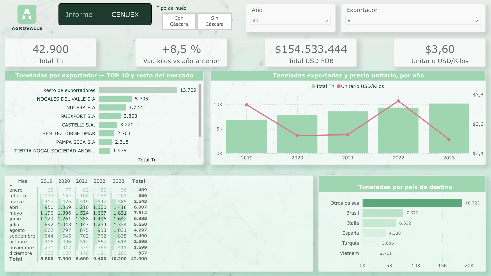
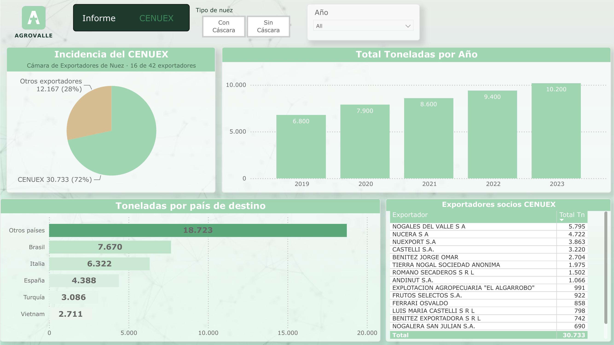

## The problem
The director of CENUEX, the walnut exporters' chamber, needed a report to present to the chamber's members: where do we stand compared with the rest of the Argentine market? Until then there was no consolidated view — each member had its own sales records, and the market-wide figures were scattered across separate publications.

## Technical highlights
- **Sources:** Excel and PDF files sent by every member of the chamber, with each sale and its price, plus market data published in PDF by an international walnut exporters' association. Multiple formats, multiple senders, no common structure.
- **ETL in Power Query:** each source was cleaned and standardized into one shipment-level table (exporter, destination, month, tonnes, FOB value) so all members and the rest of the market could be compared on the same basis.
- **Price per kilo (USD/kg):** total USD FOB divided by total kilos — a ratio of sums, not an average of per-shipment prices, so large shipments weigh more than small ones and the figure matches what the market actually earned per kilo.
- **Market vs. chamber:** the same model serves both views; the chamber share is calculated against the full-market total, and members' figures are labeled separately so they are never added to the market total by mistake.

## What I would do differently today
- **Modernize the report's look and navigation:** cleaner KPI cards and page navigation built for a quicker read.
- **Automate the ETL with an AI agent:** with so many senders and formats, an agent could extract the data from every Excel and PDF into a single flat file, ready for Power Query, instead of preparing each source by hand.
- **Add a validation step to that extraction:** check every member's extracted totals against the totals in their original file, so automation doesn't introduce silent errors.

## Screenshots
| Cover | Households & products |
|---|---|
|  |  |

## How to open it
Download [`report/agrovalle-export.pbix`](report/agrovalle-export.pbix) and open it with [Power BI Desktop](https://www.microsoft.com/power-platform/products/power-bi/desktop) (free, Windows).

## Author
**Federico Sequeiros** · BI Developer · [LinkedIn](https://www.linkedin.com/in/federico-sequeiros)